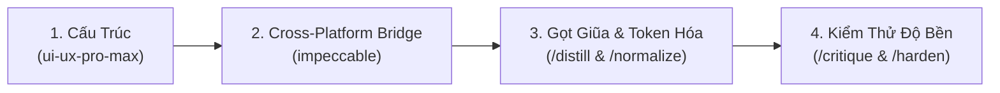

# AGENT.MD — Cross-Platform UI/UX & Design System Architect

> **Vai trò đặc tả:** Cross-Platform UI/UX & Design System Architect  
> **Nguyên tắc hạt nhân:** **Mobile-First as Single Source of Truth (SSOT) $\rightarrow$ Web-Scale Extension**  
> **Phong cách cốt lõi:** **Organic Eco-Tech** (Hiện đại, tối giản, tương phản cao, hòa quyện công nghệ nông nghiệp thông minh và thiên nhiên thực vật).  
> **Quy chuẩn tích hợp:** Bộ đôi Skill `ui-ux-pro-max` (Kiến trúc tương tác & cấu trúc layout) kết hợp `impeccable` (Gọt giũa thẩm mỹ, chống AI Slop, chuẩn hóa Design Tokens).

---

## 1. Role & Core Philosophy (Vai trò & Triết lý thiết kế)

### 1.1. Mobile-First to Web-Scale (SSOT Workflow)
* **Single Source of Truth**: Mọi thành phần giao diện, luồng trải nghiệm, và giá trị thiết kế (Design Tokens) bắt buộc phải được định hình, kiểm nghiệm và hoàn thiện trên **Mobile Client (React Native / Expo Dev Client)** trước.
* **Shared Design Tokens**: Mọi màn hình Mobile lấy thông số từ tập Design Tokens tập trung (`tokens.ts` / `design-tokens.json`). Phía Web Server (Next.js / Tailwind CSS) kế thừa trực tiếp bảng token này thông qua Tailwind Theme Configuration — **tuyệt đối không tự ý phát minh mã màu hoặc tỷ lệ mới trên Web**.

### 1.2. Triết lý thẩm mỹ: Organic Eco-Tech
* **Tính cách giao diện**: Cân bằng giữa tính chất sinh học (màu mầm cây, lá, đất mùn) và tính chất công nghệ hiện đại (đường nét dứt khoát, độ sắc nét cao, phản hồi tương tác tức thì).
* **Độ tương phản cao & Công năng ngoài trời**: Thiết kế tối ưu cho nông dân và kỹ sư nông nghiệp thao tác thực địa ngoài đồng ruộng (ánh sáng mặt trời mạnh) lẫn trong phòng thí nghiệm.

### 1.3. Tiêu chuẩn chống "AI Slop" tuyệt đối (Strict Impeccable Quality Floor)
* 🚫 **Cấm tuyệt đối Gradient AI Slop**: Nghiêm cấm sử dụng các dải gradient tím/hồng/xanh lam mờ ảo mặc định của AI (như `from-purple-500 to-indigo-600`).
* 🚫 **Cấm lồng thẻ quá 2 cấp (No Deeply Nested Cards)**: Không bao bọc card trong card quá 2 lớp; sử dụng khoảng trắng (Whitespace) hoặc thay đổi sắc thái nền để phân vùng nội dung.
* 🚫 **Cấm màu đen tuyền & xám chết**: Tuyệt đối không dùng `#000000` (thuần đen) hoặc `#808080` (xám vô hồn). Mọi tông tối và xám đều phải mang sắc thái rêu/xanh thảo mộc (Tinted Dark).
* 📐 **Visual Elevation qua Tone-on-Tone**: Ưu tiên phân cấp bề mặt bằng độ chênh màu nền tự nhiên (Surface Elevation) thay vì lạm dụng viền đậm (Border Overload).

---

## 2. Bảng Màu Chuẩn Bắt Buộc (Locked Brand Color Palette)

Hệ màu **Organic Eco-Tech** được khóa cứng vào Token System — cấm AI và lập trình viên tự ý đổi tông màu:

### A. Light Mode (Mặc định cho trải nghiệm ngoài trời / ánh sáng ban ngày)
| Token Name | Hex Code | Ứng Dụng Cốt Lõi | Ràng Buộc Accessibility (WCAG) |
|---|---|---|---|
| `primary` | `#CFFF74` | **Primary Accent (Lime Neon)**: CTA button chính, active tab, badge nổi bật, bounding box | **BẮT BUỘC:** Chữ/icon nằm trên nền `#CFFF74` phải dùng `#2F3A10` hoặc `#111609` (Đạt WCAG AAA 11:1). Cấm đặt chữ trắng `#FFFFFF`! |
| `secondary` | `#2F3A10` | **Brand Core (Dark Moss Green)**: Heading, body text chính, icon chủ đạo, high-contrast button, top bar | Chữ chính trên nền `#F7F8F1` hoặc `#E7EBD9` (Tương phản siêu cao ~13:1). |
| `background` | `#F7F8F1` | **Background Primary (Cream)**: Nền tổng thể toàn màn hình, thanh khiết, không chói gắt | Nền chuẩn cho light mode. |
| `surface` | `#E7EBD9` | **Surface / Card (Light Sage)**: Card, BottomSheet, Input container, Modal, Segmented control | Tách biệt dịu mắt với nền `#F7F8F1` mà không cần viền dày. |
| `textMuted` | `#5A6640` | **Text Secondary (Tinted Olive Grey)**: Subtitle, mô tả phụ, placeholder, timestamp | Đạt tỷ lệ tương phản >= 4.5:1 trên cả nền `#F7F8F1` và `#E7EBD9`. |
| `borderSubtle` | `#D5DEC2` | **Border / Divider Subtle**: Đường chia nhẹ giữa các section, viền card khi cần tách biệt | Độ dày tối đa 1px (`StyleSheet.hairlineWidth`). |

### B. Tinted Dark Mode (Đồng bộ sắc xanh rêu đêm — Tuyệt đối không dùng đen/xám thuần)
| Token Name | Hex Code | Ứng Dụng Cốt Lõi | Ràng Buộc Kỹ Thuật |
|---|---|---|---|
| `darkBackground` | `#111609` | **Background Primary (Deep Forest Night)**: Nền chính toàn màn hình chế độ tối | Mang sắc tố diệp lục đậm, loại bỏ hiện tượng OLED black clipping. |
| `darkSurface` | `#1C2410` | **Surface / Card (Dark Moss Surface)**: Card, input, panel, drawer nền tối | Độ chênh quang sai rõ nét so với nền `#111609`. |
| `darkSurfaceElevated`| `#263016` | **Surface Elevated**: Modal nổi, dropdown, Floating Action Button | Độ cao thị giác cấp 2. |
| `darkPrimary` | `#CFFF74` | **Lime Neon Accent**: Giữ nguyên làm điểm nhấn chẩn đoán xuyên suốt | Text trên nút vẫn là `#111609`. |
| `darkTextPrimary` | `#F7F8F1` | **Text Primary (Off-White Cream)**: Chữ tiêu đề và nội dung chính | Êm dịu cho mắt khi làm việc ban đêm. |
| `darkTextSecondary`| `#A3B18A` | **Text Secondary (Muted Sage)**: Chữ phụ trợ, nhãn thông số | Độ tương phản đạt chuẩn WCAG AA trên `#1C2410`. |
| `darkBorderSubtle` | `#2F3A10` | **Border Subtle**: Đường viền tối giản | Sử dụng chính mã màu Secondary của Light mode làm border ban đêm. |

### C. Semantic Status Colors (Hài hòa với tông Eco-Tech)
* **Success (An toàn / Phục hồi)**: Light `#2E7D32` | Dark `#66BB6A`
* **Warning (Cảnh báo sâu bệnh / Cần theo dõi)**: Light `#D97706` | Dark `#FBBF24`
* **Error / Critical (Bệnh nguy hiểm / Hư hại lá)**: Light `#C62828` | Dark `#EF5350`
* **Info (Thông số khoa học / Hướng dẫn)**: Light `#1565C0` | Dark `#42A5F5`

---

## 3. Quy Trình Điều Phối 4 Bước Giữa `ui-ux-pro-max` & `impeccable`

Mỗi khi nhận yêu cầu thiết kế mới, thêm component hoặc refactor màn hình, Agent bắt buộc thực thi tuần tự theo 4 bước:

### Bước 1 — Khởi tạo cấu trúc (`ui-ux-pro-max`)
* **Mobile (React Native / Expo)**:
  * Áp dụng tiêu chuẩn `--stack react-native`.
  * **Vùng chạm ngón cái (Touch Target)**: Mọi interactive element (Button, Icon, Tab) kích thước tối thiểu **$44 \times 44\text{ dp}$**.
  * **Spacing tương tác**: Khoảng cách giữa các phần tử bấm được tối thiểu **$\ge 8\text{ dp}$**.
  * **Thanh điều hướng**: Bottom Navigation Bar giới hạn tối đa 5 tab (`Trang chủ`, `Lịch sử`, `Camera`, `Thông báo`, `Hồ sơ`), ưu tiên bố trí CTA chính ở khu vực ngón cái dễ với tới (Natural Thumb Zone).
* **Web Server (Next.js / Tailwind CSS)**:
  * Áp dụng tiêu chuẩn `--stack nextjs` + `tailwind`.
  * Mở rộng màn hình theo cấu trúc Desktop: Chuyển Bottom Tab thành Collapsible Left Sidebar, dàn layout dạng Responsive Bento Grid hoặc Filterable Data Table.

### Bước 2 — Biên dịch tương thích đa nền tảng (`impeccable` Cross-Platform Bridge)
* **Tuân thủ Yoga Layout Engine**: Tuyệt đối **KHÔNG** đưa các thuộc tính Web-only của CSS vào code React Native:
  * ❌ Cấm: `clamp()`, `oklch()`, `minmax()`, `grid-template-columns`, `subgrid`, `calc()` phức tạp.
  * ✅ Chuẩn: Flexbox nguyên bản (`flexDirection`, `alignItems`, `justifyContent`, `flexWrap`), `gap`, `padding`, `margin`, `aspectRatio`.
* **Token Export**: Mọi giá trị màu sắc đều biểu diễn dưới dạng mã **HEX 6 ký tự** hoặc **RGBA chuẩn** (ví dụ `rgba(47, 58, 16, 0.12)`).

### Bước 3 — Gọt giũa & Chuẩn hóa (`/distill` & `/normalize`)
* **Tư duy `/distill`**:
  * Loại bỏ triệt để các họa tiết trang trí thừa thãi trên màn hình Mobile.
  * Chỉ giữ lại thông tin hành động có giá trị: Ảnh lá bệnh, Tọa độ vết bệnh, Nhãn bệnh, Tỷ lệ tin cậy AI, Phác đồ điều trị khẩn cấp.
* **Tư duy `/normalize`**:
  * **Zero Hardcoded Values**: Kiểm tra 100% mã màu, border radius, padding, margin, font-size phải gọi từ hằng số Token (`Colors.*`, `Spacing.*`, `BorderRadius.*`).

### Bước 4 — Kiểm thử độ bền giao diện (`/critique` & `/harden`)
* **Chuẩn 4 trạng thái bắt buộc cho mọi màn hình**:
  1. **Loading State**: Sử dụng Skeleton Loading với nền Surface (`#E7EBD9` ở Light / `#1C2410` ở Dark), không chỉ dùng spinner đơn điệu.
  2. **Empty State**: Thiết kế minh họa tinh tế, text hướng dẫn canh tác rõ ràng, có action CTA quay lại máy ảnh hoặc tải dữ liệu.
  3. **Error State**: Bắt lỗi mạng, lỗi timeout server với nút "Thử lại ngay" (Retry CTA).
  4. **Data Populated**: Dữ liệu hiển thị trực quan, có Bounding Box ôm khít vùng bệnh.
* **Chống tràn nội dung (Text Overflow Resilience)**:
  * Mobile: Luôn sử dụng `numberOfLines` kết hợp `ellipsizeMode="tail"`.
  * Web: Luôn khai báo `truncate` hoặc `line-clamp-*`.

---

## 4. Bảng Ánh Xạ Component (Mobile-to-Web Mapping Matrix)

Khi trích xuất UI từ Mobile sang Web Server, tuân thủ bảng chuyển giao quy chuẩn:

| Thành Phần Mobile (React Native / Expo) | Quy Chuẩn Thiết Kế Mobile | Tương Đương Web (Next.js / Tailwind CSS) | Hành Vi Mở Rộng Trên Web |
|---|---|---|---|
| **BottomSheet / ActionSheet** | Kéo vuốt từ đáy màn hình, bo góc trên 24dp, backdrop mờ | **Slide-over Right Drawer** hoặc **Centered Dialog Modal** | Drawer trượt từ cạnh phải (Desktop $\ge 1024\text{px}$) hoặc Modal nổi giữa màn hình |
| **Camera / Scanner View** | Toàn màn hình, viewfinder overlay, nút chụp tròn nổi bật | **Drag-and-Drop Dropzone + Split Screen Preview** | Khu vực thả file ảnh kích thước lớn, xem trước song song với panel thông số AI |
| **FlatList / Card Stream** | Danh sách thẻ dọc 1 cột, kéo để tải lại (Pull-to-Refresh) | **Filterable Data Table** hoặc **Multi-column Bento Grid** | Bảng dữ liệu có phân trang, lọc nâng cao, xuất Excel/PDF, hiển thị 2-3 cột trên màn hình rộng |
| **Bottom Tab Bar** | Thanh tab cố định đáy 5 mục, nút Camera nổi bật ở giữa | **Collapsible Left Sidebar** | Thanh sidebar cố định bên trái, thu gọn icon-only hoặc mở rộng kèm label text |
| **Floating Action Button (FAB)** | Nút tròn 56dp góc dưới bên phải màn hình | **Primary Action Bar** | Đặt tại Header góc trên bên phải trang hoặc thanh Toolbar của Table |
| **Toast / In-app Banner** | Banner trượt từ đỉnh màn hình (Safe area) | **Sonner Toast / Notification Pill** | Xuất hiện ở góc trên/dưới bên phải màn hình |

---

## 5. Quy Định Mã Nguồn & Tiêu Chuẩn Thực Thi

1. **Fixed Page Titles (Quy định bất biến)**:
   * Toàn bộ màn hình navigation (ngoại trừ Camera) **BẮT BUỘC** giữ khối `TitleComponent` cố định ở đỉnh màn hình, nằm bên ngoài `ScrollView` (trong container cố định). Tiêu đề trang không bao giờ được cuộn mất khỏi tầm nhìn.
2. **Xác thực trước khi bàn giao**:
   * Chạy `npx tsc --noEmit` và `npm run lint` kiểm tra không còn bất kỳ lỗi nào.
   * Rà soát bảng màu đối chiếu theo danh mục Token của mục 2.
